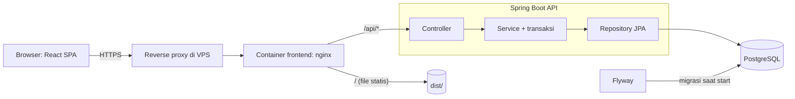
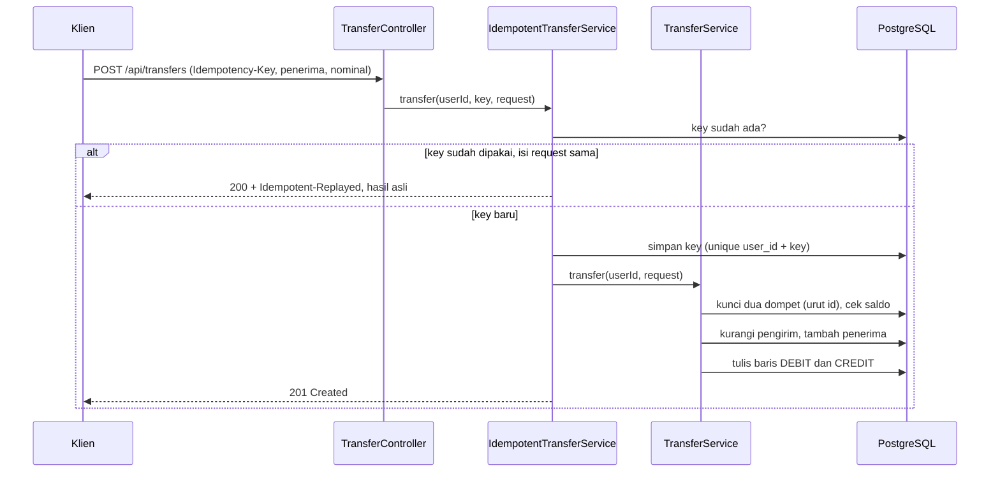
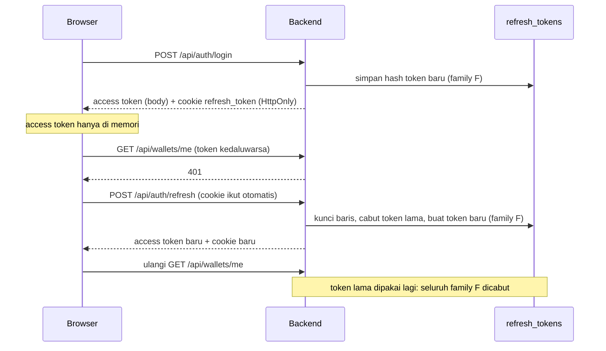
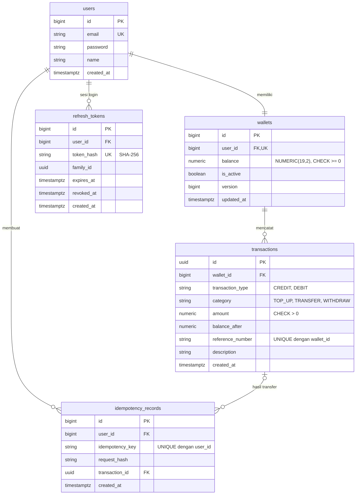

# E-Wallet

Simulasi dompet digital (e-wallet) yang dibuat sebagai proyek portofolio backend. Fokusnya bukan sekadar CRUD, tetapi **konsistensi data keuangan**: transfer atomik, pencatatan transaksi gaya double-entry, penanganan akses bersamaan (concurrency), idempotency key untuk mencegah transfer ganda, dan sesi login dengan **refresh token yang berotasi**. Di atasnya ada klien React bertema buku tabungan.

## Fitur

- Registrasi dan login. Password di-hash dengan BCrypt, dompet dibuat otomatis saat registrasi
- **Sesi aman**: access token JWT (HS256) hanya hidup di memori browser, refresh token opaque disimpan sebagai hash di PostgreSQL dan dikirim lewat cookie `HttpOnly` + `SameSite=Strict`
- **Rotasi refresh token** dengan deteksi pemakaian ulang: token lama yang dipakai lagi mencabut seluruh sesinya
- Cek saldo, top up, dan transfer antar pengguna
- **Transfer atomik** dengan locking pesimistis (dua dompet dikunci urut berdasarkan id supaya tidak deadlock)
- **Idempotency key**: transfer yang diulang (misalnya koneksi putus) mengembalikan hasil aslinya, tidak mengirim dua kali
- Riwayat transaksi dengan paginasi, lengkap dengan saldo berjalan per baris
- Dokumentasi API otomatis (Swagger UI) dan error seragam dalam format ProblemDetail

## Teknologi

| Lapisan         | Teknologi                                                                             |
| --------------- | ------------------------------------------------------------------------------------- |
| Backend         | Java 21, Spring Boot 4.1.1 (Web MVC, Data JPA, Validation, Security, Actuator), Maven |
| Database        | PostgreSQL 16, Flyway (migrasi)                                                       |
| Auth            | Spring Security (resource server JWT HS256), refresh token buatan sendiri             |
| Dokumentasi API | springdoc-openapi (Swagger UI)                                                        |
| Frontend        | React 19, Vite, TypeScript, React Router, TanStack Query, Tailwind CSS 4              |
| Test            | JUnit 6, Mockito, MockMvc (integration test dengan PostgreSQL asli), Vitest           |
| Infrastruktur   | Docker (multi-stage, user non-root), Docker Compose per bagian, nginx                 |

## Arsitektur

Aplikasi berlapis sederhana: controller tipis, service memegang logika bisnis dan transaksi, repository Spring Data JPA. Frontend dan API disajikan dari **satu origin** (lewat nginx di container frontend, atau proxy Vite saat development), sehingga cookie `SameSite=Strict` ikut terkirim dan CORS tidak terlibat.



### Alur transfer

Satu transfer menghasilkan **dua baris** di tabel `transactions` yang memakai `reference_number` yang sama: `DEBIT` untuk pengirim dan `CREDIT` untuk penerima. Kuncinya dicatat paling awal, sebelum uang bergerak, sehingga dua request dengan key yang sama tidak bisa sama-sama lolos.



### Alur sesi dan refresh token



## Model Data



Keputusan desain:

- Uang disimpan sebagai `NUMERIC(19,2)` dan dihitung dengan `BigDecimal`, tidak pernah `double`.
- Database ikut menjaga integritas lewat constraint: `balance >= 0`, `amount > 0`, `UNIQUE(reference_number, wallet_id)`.
- `transactions.balance_after` menyimpan saldo setelah mutasi. Dari sinilah kolom saldo berjalan di riwayat berasal, tanpa menghitung ulang.
- Skema dikelola Flyway (`src/main/resources/db/migration`); Hibernate hanya memvalidasi (`ddl-auto=validate`).
- `refresh_tokens` hanya menyimpan hash SHA-256, jadi kebocoran database tidak membocorkan token yang bisa dipakai.

## Autentikasi

Dua token dengan peran berbeda:

|               | Access token                                       | Refresh token                                                                        |
| ------------- | -------------------------------------------------- | ------------------------------------------------------------------------------------ |
| Bentuk        | JWT HS256, berisi id pengguna                      | String acak (opaque)                                                                 |
| Disimpan di   | Memori JavaScript                                  | Cookie `HttpOnly`, `SameSite=Strict`, `Path=/api/auth`, `Secure` di produksi |
| Umur          | `JWT_EXPIRATION_MINUTES` (60 menit)              | `JWT_REFRESH_EXPIRATION_DAYS` (7 hari)                                             |
| Dipakai untuk | Header `Authorization: Bearer` di setiap request | Hanya ke `/api/auth/refresh` dan `/api/auth/logout`                              |

- JavaScript tidak pernah melihat refresh token, jadi XSS tidak bisa mencurinya. Access token yang hilang saat halaman dimuat ulang dipulihkan diam-diam lewat cookie.
- Setiap refresh **berotasi**: token lama dicabut, token baru diterbitkan dalam family yang sama. Memakai token yang sudah dirotasi dianggap pencurian dan mencabut seluruh family.
- Baris refresh token dikunci saat dibaca (`FOR UPDATE`), jadi dua refresh bersamaan dengan token yang sama hanya satu yang berhasil.
- Di frontend, refresh bersamaan dalam satu tab berbagi satu request (single-flight), dan antar tab diserialkan lewat Web Locks, supaya rotasi tidak salah dikira pencurian.
- Logout mencabut seluruh family sesi itu dan menghapus cookie. Logout tanpa cookie tetap sukses (204).

## Aturan Bisnis

- Nominal antara 0,01 dan 100.000.000,00 dengan maksimal 2 angka desimal.
- Pengguna tidak bisa transfer ke dirinya sendiri, ke email yang tidak terdaftar, atau melebihi saldo.
- Dompet yang tidak aktif tidak bisa dipakai bertransaksi.
- `Idempotency-Key` bersifat opsional, maksimal 100 karakter, berlaku per pengguna. Key yang sama dengan isi request berbeda ditolak (422). Request yang diulang dengan isi sama mengembalikan hasil asli dengan header `Idempotent-Replayed: true`.
- Dompet selalu diambil dari id di token, bukan dari input klien, jadi pengguna hanya bisa menyentuh dompetnya sendiri.

## Mengakses API

- Base URL: `http://localhost:8080`. Dokumentasi interaktif: `/swagger-ui.html`, spesifikasi OpenAPI: `/v3/api-docs`.
- Endpoint selain register, login, refresh, dan logout wajib memakai header `Authorization: Bearer <access token>`.
- Sukses mengembalikan objek langsung. Daftar berpaginasi: `{ content, page, size, totalElements, totalPages }`.
- Error memakai ProblemDetail: `{ "title", "status", "detail" }`. Error validasi menambahkan `errors` berisi pesan per kolom. Error 500 tidak membocorkan detail internal.
- Nominal uang dikirim sebagai angka JSON.

| Area        | Endpoint                                                                                                                 |
| ----------- | ------------------------------------------------------------------------------------------------------------------------ |
| Auth        | `POST /api/auth/register` (201), `POST /api/auth/login`, `POST /api/auth/refresh`, `POST /api/auth/logout` (204) |
| Profil      | `GET /api/users/me`                                                                                                    |
| Dompet      | `GET /api/wallets/me`, `POST /api/wallets/top-up` (201)                                                              |
| Transfer    | `POST /api/transfers` (201, atau 200 bila diulang dengan `Idempotency-Key` yang sama)                                |
| Riwayat     | `GET /api/transactions?page=0&size=20` (terbaru lebih dulu)                                                            |
| Operasional | `GET /actuator/health`                                                                                                 |

Kode error yang umum: `400` validasi atau transfer ke diri sendiri, `401` kredensial atau token salah, `403` dompet tidak aktif, `404` penerima tidak ditemukan, `409` email sudah terdaftar, `422` saldo kurang atau idempotency key dipakai ulang dengan isi berbeda.

## Menjalankan Secara Lokal

Prasyarat: JDK 21, Docker, Node.js 20+ dan [pnpm](https://pnpm.io).

```bash
# 1. Konfigurasi (semua pengaturan ada di satu file)
cd backend
cp .env.example .env            # PowerShell: Copy-Item .env.example .env
cd ..

# 2. Database saja, dari folder backend/ (port database dibuka ke localhost)
cd backend
docker compose up -d db

# 3. Backend, di terminal pertama (masih di folder backend/)
./mvnw spring-boot:run          # Windows: mvnw.cmd spring-boot:run

# 4. Frontend, di terminal kedua (dari root repo)
cd frontend
pnpm install
pnpm dev                        # http://localhost:5173
```

Saat start, Flyway membuat tabel otomatis. Di development, Vite meneruskan `/api` ke backend, jadi browser melihat satu origin dan cookie refresh token ikut terkirim. Port dan alamat backend untuk proxy bisa diubah lewat `frontend/.env` (lihat `frontend/.env.example`).

## Konfigurasi

Semua yang berbeda antara development dan server ada di file `.env`: `backend/.env` untuk API dan database, `frontend/.env` untuk frontend (opsional). Kode dan file compose tidak perlu diubah saat deploy.

**`backend/.env`**

| Variabel                        | Fungsi                                                                       | Bawaan                                          |
| ------------------------------- | ---------------------------------------------------------------------------- | ----------------------------------------------- |
| `DB_NAME`                     | Nama database                                                                | `ewallet`                                     |
| `DB_USERNAME`                 | User database                                                                | `ewallet`                                     |
| `DB_PASSWORD`                 | Password database. **Ganti di produksi**                               | `ewallet`                                     |
| `DB_PORT`                     | Port database di komputer development (`docker-compose.yml`)           | `5432`                                        |
| `DB_URL`                      | JDBC URL. Di `docker-compose.yml` diatur otomatis; produksi: alamat PostgreSQL native    | `jdbc:postgresql://localhost:5432/ewallet`    |
| `SERVER_PORT`                 | Port aplikasi untuk `./mvnw` (di Docker dikunci 8080; ubah `APP_PORT`) | `8080`                                        |
| `APP_BIND`                    | Alamat tempat API dibuka (`docker-compose.prod.yml`). Biarkan `127.0.0.1`                    | `127.0.0.1`                                   |
| `APP_PORT`                    | Port di komputer/server tempat API dibuka                                             | `8080`                                        |
| `JWT_SECRET`                  | Kunci penandatangan token, minimal 32 karakter. **Ganti di produksi**  |                                                 |
| `JWT_EXPIRATION_MINUTES`      | Umur access token (menit)                                                    | `60`                                          |
| `JWT_REFRESH_EXPIRATION_DAYS` | Umur refresh token (hari)                                                    | `7`                                           |
| `COOKIE_SECURE`               | Cookie refresh hanya lewat HTTPS. **Isi `true` di produksi**         | `false`                                       |
| `CORS_ALLOWED_ORIGINS`        | Alamat frontend yang diizinkan, dipisah koma. **Isi domain produksi**  | `http://localhost:3000,http://localhost:5173` |
| `SWAGGER_ENABLED`             | Buka atau tutup Swagger UI dan `/v3/api-docs`                              | `true`                                        |

**`frontend/.env`** (semuanya punya nilai bawaan; frontend tidak menanam variabel apa pun saat build, jadi satu build bisa dipakai di domain mana pun)

| Variabel         | Fungsi                                                                                         | Bawaan                  |
| ---------------- | ---------------------------------------------------------------------------------------------- | ----------------------- |
| `DEV_PORT`       | Port `pnpm dev`                                                                                | `5173`                  |
| `DEV_API_TARGET` | Alamat backend untuk proxy `/api` saat `pnpm dev`                                              | `http://localhost:8080` |
| `WEB_BIND`       | Alamat tempat frontend dibuka (`docker-compose.prod.yml`). Biarkan `127.0.0.1`                                   | `127.0.0.1`             |
| `WEB_PORT`       | Port di komputer/server tempat frontend dibuka                                                          | `3000`                  |
| `BACKEND_URL`    | Tujuan proxy `/api` dari container nginx. Bawaan cocok bila dijalankan bersama backend di root | `http://app:8080`       |

File `.env` tidak boleh di-commit (sudah ada di `.gitignore`). `JWT_SECRET` tidak punya nilai bawaan di aplikasi, jadi aplikasi menolak start tanpa itu.

## Deploy di VPS

Setiap bagian punya dua file Docker Compose, dan dua file di root hanya memanggil keduanya (`include`, tanpa konfigurasi sendiri):

| File | Isi |
| --- | --- |
| `backend/docker-compose.yml` | **Development**: container PostgreSQL + API |
| `backend/docker-compose.prod.yml` | **Server**: API saja, database memakai PostgreSQL native di server |
| `frontend/docker-compose.yml` | Development: nginx + aplikasi web |
| `frontend/docker-compose.prod.yml` | Server: nginx + aplikasi web (restart otomatis) |
| `docker-compose.yml` (root) | Memanggil dua file development di atas |
| `docker-compose.prod.yml` (root) | Memanggil dua file server di atas |

| Perintah | Menjalankan |
| --- | --- |
| `docker compose up -d --build` (dari root) | Development: database, API, dan frontend |
| `docker compose -f docker-compose.prod.yml up -d --build` (dari root) | Server: API dan frontend |
| `docker compose up -d --build` (dari `backend/` atau `frontend/`) | Development, bagian itu saja |
| `docker compose -f docker-compose.prod.yml up -d --build` (dari `backend/` atau `frontend/`) | Server, bagian itu saja |

Docker Compose 2.20 atau lebih baru dibutuhkan untuk `include`. Compose membaca file `.env` di folder masing-masing secara otomatis, jadi tidak perlu `--env-file`. Versi development dan server memakai nama container yang sama, jadi jalankan salah satu saja.

Di server, API dan frontend hanya terbuka di `127.0.0.1` (diatur `APP_BIND`/`APP_PORT` dan `WEB_BIND`/`WEB_PORT`), dan akses dari internet lewat reverse proxy dengan HTTPS. Container frontend berisi nginx yang menyajikan aplikasi, meneruskan `/api/` ke API di jaringan Docker, dan menambahkan header keamanan (CSP, `X-Frame-Options`, dll). Karena hanya `/api/` yang diteruskan, Swagger UI dan `/actuator` tidak terbuka ke publik.

1. **Siapkan PostgreSQL native** di server (sekali saja). Buat user dan database:
   ```bash
   sudo -u postgres psql -c "CREATE USER ewallet WITH PASSWORD 'password-kuat';"
   sudo -u postgres psql -c "CREATE DATABASE ewallet OWNER ewallet;"
   ```
   Lalu izinkan container Docker menjangkaunya. Di `postgresql.conf`, tambahkan alamat Docker host (cek dengan `ip addr show docker0`, biasanya `172.17.0.1`):
   ```
   listen_addresses = 'localhost,172.17.0.1'
   ```
   Di `pg_hba.conf`, izinkan jaringan Docker memakai akun itu:
   ```
   host  ewallet  ewallet  172.16.0.0/12  scram-sha-256
   ```
   Restart PostgreSQL (`sudo systemctl restart postgresql`). Jika memakai `ufw`, izinkan juga: `sudo ufw allow from 172.16.0.0/12 to any port 5432`. Port 5432 tidak dibuka ke internet.
2. Salin proyek ke server, lalu buat `backend/.env` dari `backend/.env.example`. Ubah: `DB_URL=jdbc:postgresql://host.docker.internal:5432/ewallet`, `DB_USERNAME`, `DB_PASSWORD` (sesuai akun di atas), `JWT_SECRET`, `COOKIE_SECURE=true`, `CORS_ALLOWED_ORIGINS` (domain frontend), dan opsional `SWAGGER_ENABLED=false`. `frontend/.env` boleh dilewati kecuali ingin mengubah port.
3. Jalankan dari root repo:
   ```bash
   docker compose -f docker-compose.prod.yml up -d --build
   ```
   Flyway membuat tabel otomatis saat API pertama kali start.
4. Arahkan reverse proxy di VPS ke container frontend, cukup satu `location`, karena nginx di container sudah membagi `/` dan `/api/`. Contoh Nginx:
   ```nginx
   server {
       listen 443 ssl;
       server_name wallet.contohmu.com;
       # ssl_certificate dan ssl_certificate_key: isi sesuai sertifikat kamu

       location / {
           proxy_pass http://127.0.0.1:3000;   # samakan dengan WEB_BIND:WEB_PORT
           proxy_set_header Host $host;
           proxy_set_header X-Forwarded-For $proxy_add_x_forwarded_for;
           proxy_set_header X-Forwarded-Proto $scheme;
       }
   }
   ```

Catatan:

- Jika `postgresql` gagal start karena alamat `172.17.0.1` belum ada saat boot (Docker belum jalan), ganti `listen_addresses = '*'` dan pastikan port 5432 diblokir dari luar oleh firewall.
- Di development, volume database bernama tetap `ewallet-data`, jadi datanya sama baik dijalankan dari `backend/` maupun dari root. `DB_USERNAME` dan `DB_PASSWORD` dipakai saat volume pertama kali dibuat; mengubahnya setelah itu tidak mengubah user di database yang sudah ada.
- Jika frontend server dijalankan sendiri (bukan lewat root), container-nya tidak bisa memakai nama `app` dan tidak bisa menjangkau API yang hanya terbuka di `127.0.0.1`. Jalankan lewat `docker-compose.prod.yml` di root.
- Untuk database terkelola (bukan PostgreSQL native), biasanya perlu SSL: tambahkan `?sslmode=require` di akhir `DB_URL`.
- Health check: `GET /actuator/health` (dari server itu sendiri, di `127.0.0.1`).
- Image bisa dibangun sendiri: `docker build -t ewallet ./backend` dan `docker build -t ewallet-web ./frontend`. `.env` tidak pernah masuk ke image (`.dockerignore`).

## Testing

```bash
# Backend (dari folder backend/). Butuh database ewallet_test, buat sekali:
#   psql -U <user> -c "CREATE DATABASE ewallet_test;"
./mvnw test

# Frontend (dari folder frontend/)
pnpm test
```

- **Backend**: unit test dengan Mockito untuk logika service, dan integration test dengan MockMvc terhadap PostgreSQL asli untuk setiap endpoint, validasi, format error, CORS, dan Swagger. Ada test konkurensi: top up paralel, transfer silang tanpa deadlock, request idempotent paralel, dan refresh token paralel (hanya satu yang berhasil). URL database test bisa diubah lewat `TEST_DB_URL`.
- **Frontend**: Vitest mencakup klien API (auto-refresh saat 401, single-flight, sesi habis, header `Idempotency-Key`, pesan error per kolom) serta pembacaan dan format nominal.

## Catatan Teknis

- **Locking pesimistis untuk uang**: saldo dibaca dan diubah dalam satu transaksi dengan `SELECT ... FOR UPDATE`. Untuk transfer, dua dompet dikunci dengan urutan id naik, sehingga transfer silang (A ke B dan B ke A bersamaan) tidak saling menunggu selamanya.
- **Idempotency tanpa celah**: key disimpan paling awal dengan unique `(user_id, key)`. Pelanggaran unique ditangkap di luar transaksi yang gagal, lalu request kedua mengembalikan hasil request pertama.
- **Satu sumber kebenaran untuk saldo berjalan**: `balance_after` dicatat saat transaksi dibuat, jadi riwayat tidak perlu menghitung ulang.
- **Error seragam**: `GlobalExceptionHandler` meluaskan `ResponseEntityExceptionHandler`, sehingga JSON rusak, method salah, atau path tidak ada juga berbentuk ProblemDetail.
- **Frontend**: klien HTTP membungkus `fetch`, menyisipkan Bearer token, dan mengulang request satu kali setelah refresh bila menerima 401. Transfer punya langkah "Periksa sebelum mengirim", dan Idempotency-Key dibuat per rencana transfer sehingga menekan kirim ulang setelah koneksi putus aman.

## Keterbatasan

- Belum ada pembatasan laju (rate limiting) pada login dan registrasi.
- Refresh token yang kedaluwarsa atau dicabut belum dibersihkan otomatis dari tabel.
- Access token tidak bisa dicabut sebelum kedaluwarsa (maksimal 60 menit); yang dicabut adalah refresh token.
- `POST /api/auth/register` mengungkap apakah email sudah terdaftar (409), jadi perlindungan terhadap enumerasi email hanya sebagian.
- Ini simulasi: tidak ada integrasi pembayaran sungguhan, dan top up langsung menambah saldo. Kategori `WITHDRAW` ada di skema tetapi belum punya endpoint.

## Struktur Proyek

```
e-wallet/
├── backend/                  # API Spring Boot: Dockerfile, docker-compose.yml, docker-compose.prod.yml, .env
├── frontend/                 # Aplikasi web (React, Vite, nginx): Dockerfile, docker-compose.yml, docker-compose.prod.yml, .env
├── docker-compose.yml        # development: memanggil compose backend dan frontend
└── docker-compose.prod.yml   # server: memanggil compose.prod backend dan frontend
```

```
backend/src/main/java/com/ewallet/
├── auth/          # register, login, JWT, refresh token, cookie
├── user/          # profil pengguna
├── wallet/        # cek saldo
├── transaction/   # riwayat, nomor referensi
├── transfer/      # top up, transfer, idempotency
├── entity/        # entity JPA dan enum
└── common/        # konfigurasi (security, OpenAPI), exception, DTO bersama
backend/src/main/resources/db/migration/   # skrip Flyway (V1 skema, V2 idempotency, V3 refresh token)

frontend/src/
├── lib/           # klien API, tipe, hook TanStack Query, format nominal
├── auth/          # AuthContext dan pemulihan sesi
├── components/    # layout, tabel catatan, komponen form
└── pages/         # masuk, daftar, beranda, isi saldo, kirim uang, riwayat
```
